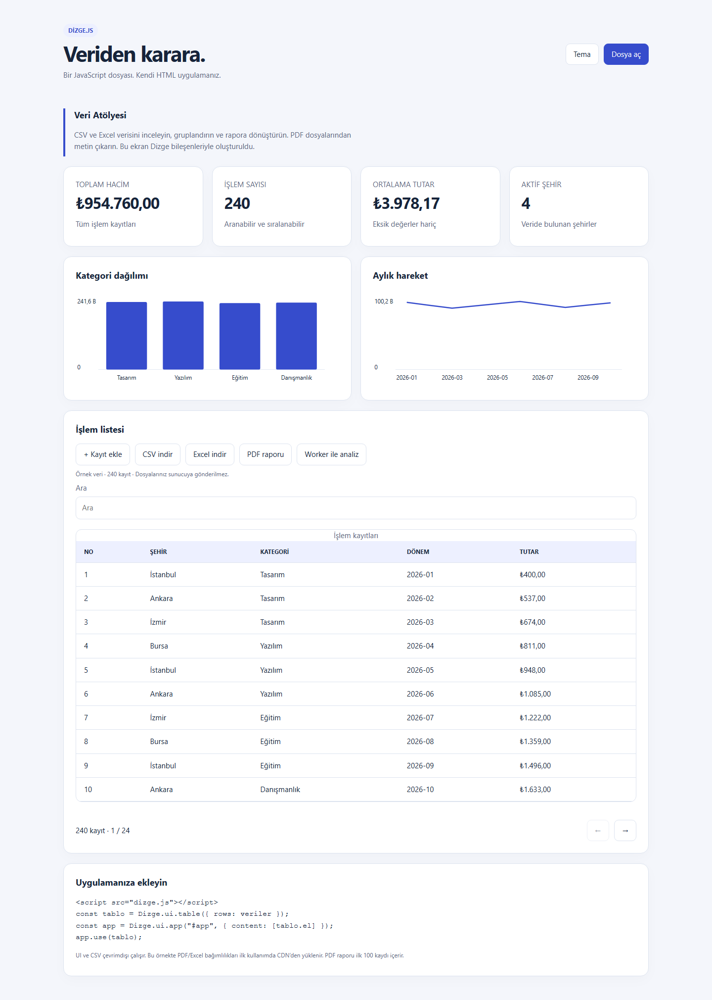
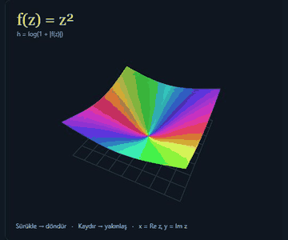
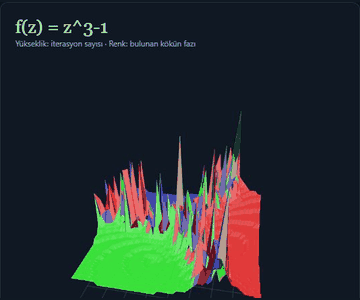
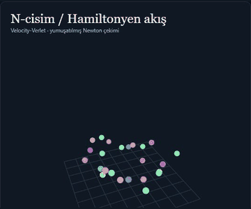
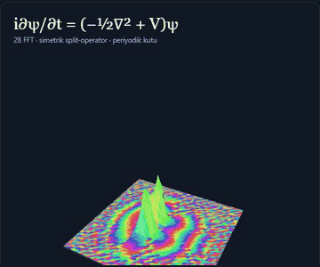

# Dizge — Türkçe Mantık Motoru ve Programlama Dili

## Yeni: Türkçe HTML etiketleri — deneysel 0.1

Sayaç, aramalı/sayfalı tablo ve veri kaynağına kayıt ekleyen form artık **kullanıcı JavaScript'i yazmadan**, Türkçe etiketlerle tanımlanabilir. `dizge-html.js` mevcut Dizge.js çekirdeğini içerir; tek bir yerel dosya yüklemek yeterlidir.

```html
<script src="dizge-html.js" defer></script>
<dz-sayfa başlık="Öğrenciler">
  <dz-veri kimlik="öğrenciler">[{"ad":"Ayşe","puan":85}]</dz-veri>
  <dz-tablo kaynak="öğrenciler" aranabilir="evet"></dz-tablo>
  <dz-sayaç başlangıç="0" adım="1"></dz-sayaç>
</dz-sayfa>
```

[Yerel örnek](examples/turkce-html.html) · [CDN ile çalışan örnek](examples/turkce-html-cdn.html) · [Etiketler, kurulum ve sınırlar](docs/turkce-html.md) · [Yol haritası](docs/TURKCE-HTML-YOL-HARITASI.md)

Depoyu indirip `examples/turkce-html.html` dosyasını tarayıcıda açın. Sağ tık → Sayfa Kaynağı'nda Türkçe uygulama tanımı okunur; motor dış dosyadadır. Motor yerelken internet gerekmez. Standart HTML kabuğu (`html`, `script` vb.) korunur; çalışma anında normal DOM üretilir. Bu özellik `.dzg` derleyicisi değildir. npm kayıt sistemine yeni bir yayın yapılmış olduğu anlamına gelmez.

## Yeni: Dizge.js 0.3.0 — Türkçe kaynak, Türkçe API, vitrin modu

**Tek dosyalık UI ve veri araç kutusu:** responsive bileşenler, sayfalı/aranabilir tablolar, SVG grafikler, formlar, gruplama/birleştirme/istatistik, CSV, Web Worker; isteğe bağlı PDF ve XLSX bağlayıcıları. Framework veya derleme zorunlu değildir.

0.3.0 ile **vitrin modu** geldi: dış HTML JS'siz ve Türkçe; gerçek uygulama Base64 iframe içinde çalışır. Sağ tıkla kaynağı açan kişi `const`, `function`, `document` görmez.

```html
<h1>Satış Paneli</h1>
<iframe title="Dizge uygulaması"
  src="data:text/html;base64,PCFkb2N0eXBlIGh0bWw+..."></iframe>
```

```sh
node scripts/vitrin.cjs uygulama.html vitrin.html \
  --baslik "Satış Paneli" --aciklama "Tek dosya uygulama"
```

[dizge.js](dizge.js) · [Küçültülmüş dağıtım](dizge.min.js) · [Türkçe API rehberi](docs/javascript-tr.md) · [Tam kullanım/API rehberi](docs/javascript.md) · [Vitrin örneği](examples/tek-dosya.html) · [Vitrin aracı](scripts/vitrin.cjs) · [Çalışan HTML örneği](examples/javascript/index.html) · [AI ile uygulama üretme rehberi](docs/javascript-ai.md) · [TypeScript](dizge.d.ts)

Vitrin örneğini yeniden üretmek için `npm run build:tek`. Örneği çalıştırmak için depoda `python -m http.server 8080`, ardından `http://localhost:8080/examples/tek-dosya.html` veya `http://localhost:8080/examples/javascript/`. PDF/Excel örneği bağımlılıkları ilk kullanımda indirir; üretimde yerel vendor dosyaları kullanılabilir. Çekirdek çevrimdışı çalışır. JS katmanı MIT lisanslıdır ve mevcut `.dzg` dilinden ayrıdır; `.dzg` derleyicisinin yerini almaz. npm kayıt sistemine yayımlanmamıştır.



---

**Türkçe eklerle yazılan akışlar, gerçek AST, doğrulanabilir sayısal sonuçlar.**

Dizge (`.dzg`), Türkçenin sondan eklemeli yapısını işlem semantiğine bağlayan deneysel bir dildir. Hâl ekleri parametreleri bağlar; fiil çatısı kopya veya yerinde değişimi seçer; uygun koşullar NumPy maskelerine derlenir.

```dzg
işlemler, bin satırlık rastgele işlem tablosudur.
tutarlar, işlemlerin tutarlarıdır.
ortalama, tutarların ortalamasıdır.
sapma, tutarların standart sapmasıdır.
eşik, sapmanın iki katıdır.
tutarların ortalamadan uzaklığı eşiği aştığı takdirde işlemler "Anormal" olarak etiketlensin.
anormaller, işlemlerden durumu "Anormal" olanların matrisidir.
anormalleri tutara göre büyükten küçüğe sıralayıp ilk onunu yazdır.
```

## Neyi iyi yapıyor?

| Yetenek | Somut karşılığı |
|---|---|
| Okunabilir veri akışı | `tutarların ortalaması` işlev çağrısını, `ortalamadan uzaklığı` karşılaştırma tabanını ifade eder. |
| Açık bellek davranışı | Etken çatı yeni değer üretir; edilgen çatı aynı nesneyi değiştirir. Testler nesne kimliğini de doğrular. |
| Gerçek derleme | Biçimbirim → SOV parser → AST → Python/NumPy; sabit katlama ve uygun koşullarda dalsız maske. |
| Genişletilebilir sözlük | `@işlev` ile eklenen kavramlar lexer sözlüğüne ve parser imzalarına katılır. |
| Türkçe kaynak | Dizge.js 0.3.0 içi Türkçe değişken, yorum, hata ve arayüz metinleri; İngilizce API alias olarak korunur. |
| Vitrin modu | Dış HTML JS'siz; uygulama Base64 iframe içinde. Sağ tıkla kaynakta JS anahtar kelimesi görünmez. |
| İncelenebilir kanıt | `.dzg` kaynakları, üretilen akışlar, NumPy referansları ve ham test sonuçları örneklerle birlikte bulunur. |

[Dil tanımı ve sınırlar](DIZGE_DILI.md) · [Çekirdek](dizge_cekirdek.py) · [Testler](test_dizge.py)

## Çalışan görsel örnekler

GIF'ler gerçek tarayıcı kareleridir; hızlandırılmış oynatılır ve performans kaydı değildir. HTML dosyalarını indirip yerelde açın: kod, stil ve matematik dosyanın içindedir.

Demolar resmi `@işlev` arayüzünü ve lexer/parser/compiler hattını kullanır. Tarayıcı için örneğe özel bir **saf AST alt kümesi → JavaScript** uyarlaması eklenmiştir. Arayüz ve grafik sürücüsü JavaScript'tir; genel amaçlı tamamlanmış bir Dizge tarayıcı arka ucu değildir.

### Kompleks Atlas — fonksiyondan 3B yüzeye



Altı kompleks fonksiyon, dört yükseklik, faz renkleri, tekillik maskeleme, nokta hesaplayıcı ve PNG/JSON dışa aktarma.

```dzg
düzlem, 2 yarıçaplı 96 çözünürlüklü kompleks düzlemdir.
kareler, düzlemin kareyüzeyidir.
genlikler, karelerin genliğidir.
yükseklikler, genliklerin logyüksekliğidir.
```

[Dizge HTML](ornekler/kompleks-atlas/dizge.html) · [Normal JS](ornekler/kompleks-atlas/normal.html) · [Kaynak ve çalıştırma](ornekler/kompleks-atlas/README.md)

### Newton topoğrafyası — formül ve otomatik türev



Güvenli parser ve dual kompleks sayılarla `f` ve `f′` birlikte hesaplanır. Yükseklik Newton adım sayısı, renk bulunan kökün fazıdır. Kutup, sıfır türev, dal kesiti ve iterasyon limiti ayrılır. JavaScript `eval` kullanılmaz.

### N-cisim sistemi — Türkçe velocity-Verlet akışı



Tohumlanmış başlangıç, yumuşatılmış çekim, 2–128 cisim, enerji ve momentum ölçümleri. İşlem sırası kaynakta okunur:

```dzg
cisimler, gökverisidir.
ivmeli, cisimlerin çekimidir.
yarım, ivmelinin yarımtekmesidir.
taşınmış, yarımın sürüklemesidir.
yeniden, taşınmışın çekimidir.
soncisimler, yenidenin yarımtekmesidir.
```

### Schrödinger dalgası — 2B FFT ve olasılık yüzeyi



Simetrik split-operator, 2B FFT, serbest/harmonik/çift yarık potansiyelleri. Yüzey `|ψ|²`, renk fazdır. Norm hatası her adımda yapay ölçeklemeyle gizlenmez. Periyodik sınır kullanılır.

[Üç laboratuvarlı Dizge HTML](ornekler/zor-deney/dizge-zor.html) · [Normal JS](ornekler/zor-deney/normal-zor.html) · [Dizge akışları](ornekler/zor-deney/akıslar.dzg) · [Kaynak ve sonuçlar](ornekler/zor-deney/README.md)

## Ölçülen sonuçlar

24 Ekim 2026 tarihli tek oturumun kayıtları:

| Kontrol | Normal JS | Dizge yaklaşımı |
|---|---:|---:|
| Kompleks Atlas ortak testleri | 76/78 | **78/78** |
| Zor deney: sayısal doğruluk | 81/81 | **81/81** |
| Zor deney: parser/girdi/sınır | 33/33 | **33/33** |
| Zor deney: ana CPU hedefleri | 3/3 | **3/3** |
| Zor deney: dış arayüz | 21/21 | **21/21** |
| Ek 16,67 ms / 60 FPS tavanı | 0/3 | 0/3 |

Çekirdeğin **18/18** testi, örnekler bu klasör yapısına taşındıktan sonra da geçti. Sayısal kontroller analitik türev, NumPy FFT, N-cisim referansı, enerji/momentum, dalga normu ve tersinirliği kapsar.

Atlas'ın normal sürümünde iki enum tür denetimi açığı bulundu. Zor deneyde ortak sayısal aşamalarla doğrudan JS ve `.dzg` AST akışları karşılaştırıldı: sonuçlar aynı, zaman aralıkları örtüşüyor. Bunlar genel hız veya AI'ye karşı mutlak üstünlük kanıtı değildir. Gösterdikleri güçlü taraf, **Türkçe akıştan incelenebilir hesaplamaya geçiş ve zor sayısal örneklerde doğruluğun korunmasıdır.**

## Kurulum ve yeniden üretim

Çekirdek: Python ≥3.10 ve NumPy.

```bash
pip install -r requirements.txt
python dizge.py hesaplama.dzg
python -m unittest -v test_dizge
```

HTML'leri kullanmak için Python/Node gerekmez. Yeniden üretmek için Python/NumPy ve Node:

```bash
python ornekler/kompleks-atlas/dizge_derle.py
node ornekler/kompleks-atlas/paketle.cjs
python ornekler/zor-deney/dzg_derle.py
node ornekler/zor-deney/paketle.cjs
node ornekler/zor-deney/node-test.cjs normal-akis.js --no-benchmark
node ornekler/zor-deney/node-test.cjs dizge-akis.js --no-benchmark
```

Tarayıcı testleri için depo kökünde `python -m http.server 8000` çalıştırın. `http://localhost:8000/ornekler/kompleks-atlas/test.html` ve `http://localhost:8000/ornekler/zor-deney/arayuz-test.html` sayfalarını açın. Ayrıntılar örnek README'lerindedir.

## Depo haritası

| Dosya/klasör | Görev |
|---|---|
| `dizge_lexer.py` | Türkçe kök/ek çözümlemesi |
| `dizge_parser.py` | SOV ayrıştırıcı, AST |
| `dizge_compiler.py` | Python/NumPy üretimi, optimizasyonlar |
| `dizge_cekirdek.py` | Sayısal sözlük, kayıt arayüzleri |
| `dizge.py` | CLI, aşama logları |
| `ornekler/*.dzg` | Zincir, bellek, koşul, matris örnekleri |
| `ornekler/kompleks-atlas/` | İlk görsel deney ve kanıtlar |
| `ornekler/zor-deney/` | Üç ileri laboratuvar ve ortak testler |
| `docs/gifs/` | Gerçek uygulama kayıtları |

Dizge v0.1 deneysel bir prototiptir. Döngü, kullanıcı tanımlı işlev ve modül sistemi henüz yoktur; ana arka uç Python/NumPy'dir. [Bilinen sınırlar](DIZGE_DILI.md).
